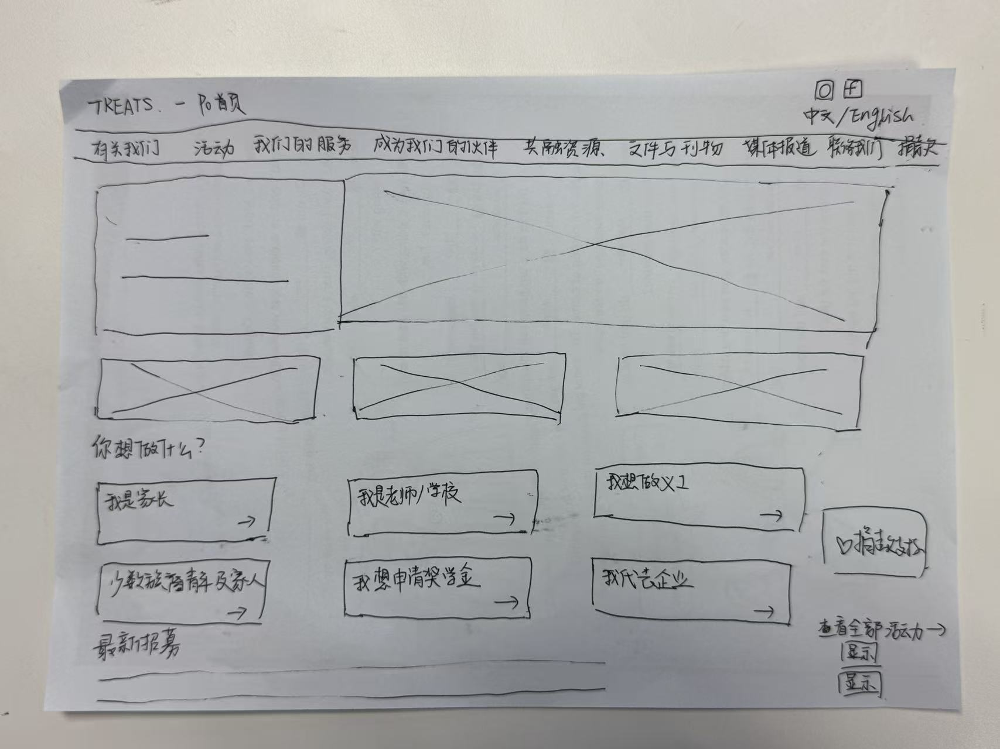
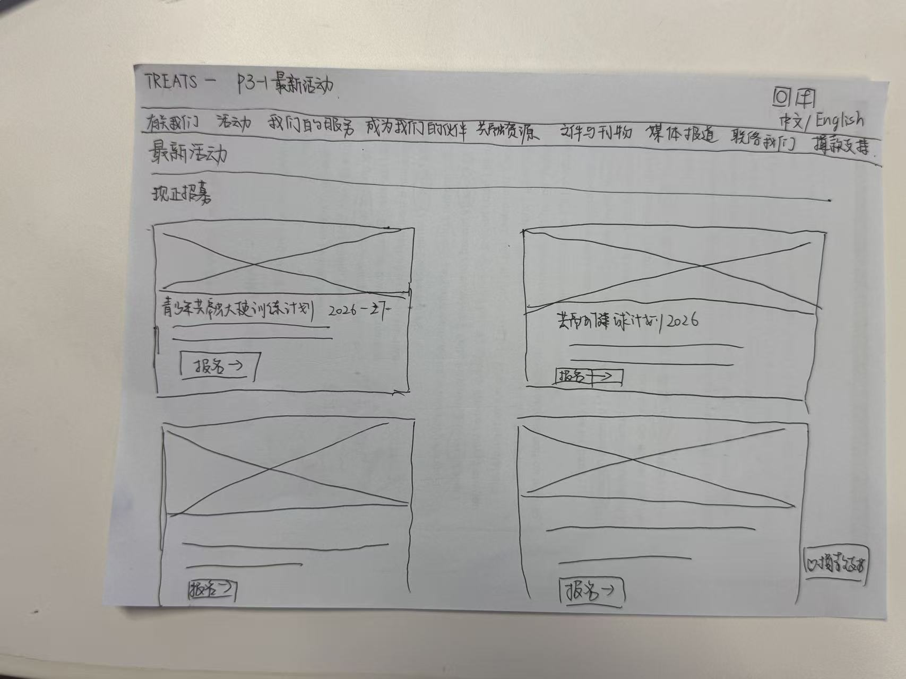
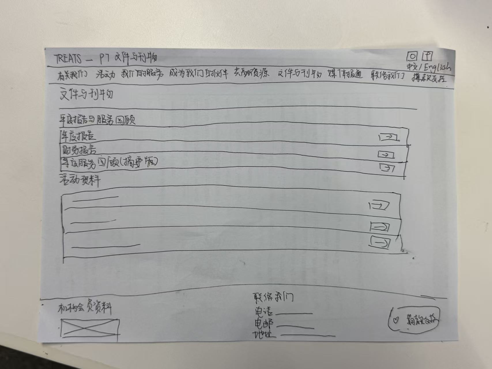

# TREATS 低保真網站原型 — Wireframes & Prototype

香港協康基金會（TREATS）網站重設計課程項目：本倉庫收錄**低保真網站原型**、**手繪線框圖**與**文字層級框架**，供評審與後續開發使用。

---

## 📁 內容結構

```
TREATS-Wireframes-Prototype/
├── README.md                                  ← 本文件
├── index.html                                 ← 可點擊的網站原型（單一檔案，雙語）
├── TREATS_site_structure_numbered.md          ← 網站文字層級框架（p0 ~ p12 全樹）
├── wireframes/                                ← 手繪線框圖（掃描照片）
│   ├── p0-home.jpg                            ← 首頁線框
│   ├── p3-1-latest-activities.jpg              ← 最新活動頁線框
│   └── p7-documents.jpg                       ← 文件與刊物頁線框
└── docs/
    └── wireframe-gallery.md                   ← 線框圖對照說明
```

---

## 🔗 線上版本

| 項目 | 連結 |
|---|---|
| **線上原型（GitHub Pages）** | https://suyutong0512-ship-it.github.io/Low-fidelity-Treats-Website-/ |
| **原型原始碼倉庫** | https://github.com/suyutong0512-ship-it/Low-fidelity-Treats-Website- |

本地預覽：下載 `index.html` 後直接用瀏覽器開啟即可，無需任何建置工具。

---

## 🖼️ 手繪線框圖

### 首頁（p0）



- 頁首導覽列 9 個主分類，右上角放「中文 / English」語言切換
- Hero 區：左側願景標語 + 主視覺位置；下方三欄圖片位置
- 「你想做什麼？」角色快速入口：家長、老師／學校、義工、少數族裔青年及家人、獎學金申請者、企業伙伴
- 右下角固定「♥ 捐款支持」浮動按鈕
- 最下方「最新招募」列表

### 最新活動（p3-1）



- 分組標籤：現正招募
- 活動卡片以雙欄排列，每張卡片含主視覺、標題、文字摘要與「報名 →」按鈕
- 已套用按鈕元素的活動標題示例：青少年共融大使訓練計劃 2026–27、共融健球計劃 2026

### 文件與刊物（p7）



- 「年度報告與服務回顧」分組：年度報告、財務報告、年度服務回顧（撮要版），每項右側帶下載圖示
- 「活動資料」分組：多個下載項目
- 頁尾區塊：機構會員資料、聯絡我們（電話／電郵／地址）、捐款支持按鈕

> 完整對照說明請見 [`docs/wireframe-gallery.md`](docs/wireframe-gallery.md)

---

## 🗂 網站文字層級框架

完整的 p0 ~ p12 樹狀編號結構請見 [`TREATS_site_structure_numbered.md`](TREATS_site_structure_numbered.md)。

頂層分類：

| 編號 | 頁面 | 一級子項數 |
|---|---|---|
| p1 | 首頁內容 | 3 |
| p2 | 有關我們 | 4 |
| p3 | 活動 | 2 |
| p4 | 我們的服務 | 4 |
| p5 | 成為我們的伙伴 | 2 |
| p6 | 共融資源 | 4 |
| p7 | 文件與刊物 | 5 |
| p8 | 媒體報道 | 1 |
| p9 | 聯絡我們 | 4 |
| p10 | 捐款支持 | 5 |
| p11 | 英文版入口 | — |
| p12 | 全站共用資訊 | 5 |

---

## 💻 原型技術說明

`index.html` 是一個**零依賴的單一檔案**原型：

- **原生 HTML + CSS + JavaScript**，無需 npm / 框架 / 建置流程
- **hash 路由**（`#p2-1`）做單頁切換，`DATA_ZH` / `DATA_EN` 兩套資料驅動
- **雙語**：`T` 翻譯物件 + `setLang()` 即時切換，導覽與內容同步更新
- **43 個可點擊頁面**，全部由 `nodes` 樹狀資料生成
- 灰階低保真風格：灰色橫條 = 原頁文字段落位置，交叉方框 = 圖片位置
- 響應式：支援桌機與 390px 手機檢視

### 常用指令

```bash
# 直接開啟
open index.html

# 或起一個本地伺服器
python3 -m http.server 8000
# 然後開 http://localhost:8000
```

---

## 👥 團隊

本項目為團隊合作完成，倉庫內保留所有成員的提交紀錄。
